<div align="center">

# 🏭 ERP Subakoua

### Cockpit stratégique pour une entreprise de fabrication de combinaisons en néoprène

**Analyse de marché · Prévision 12 mois · Optimisation de la part de marché · Simulation intégrée de la production, des achats, des RH et de la trésorerie**

[](https://www.python.org/)
[](https://streamlit.io/)
[](https://aiven.io/)
[](https://playwright.dev/)
[](https://docs.pytest.org/)
[](#licence)

</div>

---

## 📑 Table des matières

1. [English summary](#-english-summary)
2. [Présentation](#-présentation)
3. [Le problème métier](#-le-problème-métier)
4. [Architecture générale](#-architecture-générale)
5. [Les 5 modules](#-les-5-modules)
6. [Le simulateur : la chaîne de décision](#-le-simulateur--la-chaîne-de-décision)
7. [Modèle de données](#-modèle-de-données)
8. [Méthodes et algorithmes](#-méthodes-et-algorithmes)
9. [Sécurité, rôles et accès](#-sécurité-rôles-et-accès)
10. [Installation et lancement](#-installation-et-lancement)
11. [Configuration](#-configuration)
12. [Tests](#-tests)
13. [Structure du dépôt](#-structure-du-dépôt)
14. [Déploiement](#-déploiement)
15. [FAQ](#-faq)

---

## 🇬🇧 English summary

**ERP Subakoua** is a strategic decision-support application built with Streamlit for a
neoprene wetsuit manufacturer taking part in the **Subakoua / Arkhe business simulation**.

> **What it is.** A full-stack analytical ERP that ingests data from a third-party simulation
> portal, forecasts 12 months of demand, optimises pricing / advertising / quality decisions
> against competitors, and simulates the downstream consequences of those decisions on
> production, purchasing (MRP), HR and cash flow.

| Capability | Implementation |
|---|---|
| **Data ingestion** | Authenticated REST client + Playwright DOM scraper → MySQL |
| **Forecasting** | ETS / Holt-Winters / damped trend, with **out-of-sample model selection** |
| **Optimisation** | Ridge regression calibration + deterministic grid search over 700 scenarios |
| **Industrial capacity** | Per-workshop bottleneck model (cutting / assembly / packaging) |
| **Financial engine** | Full P&L, VAT, BFR, debt & cash-flow projection in `Decimal` |
| **Document purchasing** | Marginal-utility knapsack over 91 purchasable data studies |
| **Access control** | Visitor (read-only) / User (full) roles, fail-closed authentication |

**Stack:** Python · Streamlit · pandas · statsmodels · SQLAlchemy · PyMySQL · Playwright · MySQL (Aiven)

**Getting started:** see [Installation](#-installation-et-lancement). The app entry point is
`erp_engine.py`, additional pages live in `pages/`.

---

## 🎯 Présentation

L'ERP Subakoua est une **application d'aide à la décision** qui centralise l'ensemble de la
gestion d'une entreprise industrielle fictive participant à une simulation d'affaires.

L'application couvre la chaîne de valeur complète d'un fabricant de combinaisons en néoprène :

```
Marché → Prix & Publicité → Production → Achats → RH → Finance → Trésorerie
```

Elle se distingue d'un ERP classique sur trois points :

1. **Elle ingère ses données automatiquement** depuis le portail de simulation, plutôt que de
   demander une saisie manuelle fast et fiable.
2. **Elle projette** les conséquences des décisions sur 12 mois et les confronte à un
   objectif concurrentiel.
3. **Elle simule** les cascades opérationnelles (capacité, MRP, masse salariale, trésorerie)
   pour convertir une intuition en chiffres.

---

## 🏭 Le problème métier

### Le contexte

Dans la simulation Subakoua, **9 entreprises** s'affrontent sur un même marché de combinaisons
en néoprène pendant **15 mois** (Année 1 Janvier → Année 2 Mars). L'entreprise pilotée par
l'application est par défaut la **n° 3**, mais le numéro est paramétrable.

Chaque mois, l'entreprise doit arbitrer entre quatre leviers :

| Levier | Impact | Contrainte |
|---|---|---|
| **Prix** de vente | Position concurrentielle directe | — |
| **Qualité** du matériau | Perception client / différenciation | Bornée à 100 |
| **Publicité de marque** | Notoriété globale | Budget mensuel |
| **Publicité produit** | Notoriété par produit | Budget mensuel |

### Le catalogue produit

| Produit | Épaisseur | Matière première | Renforts | Manchons | Fermetures |
|---|---|---|---|---|---|
| Shorty 3 | 3 mm | Néoprène 3 · 1,1 kg | 12 kg | 2 kg | 1 kg |
| Integral 3 | 3 mm | Néoprène 3 · 1,6 kg | 18 kg | 4 kg | 1 kg |
| Shorty 5 | 5 mm | Néoprène 5 · 1,1 kg | 12 kg | 2 kg | 1 kg |
| Integral 5 | 5 mm | Néoprène 5 · 1,6 kg | 18 kg | 4 kg | 1 kg |
| Integral 7 | 7 mm | Néoprène 7 · 1,6 kg | 22 kg | 4 kg | 1 kg |

**Temps standards par unité (minutes) :**

| Produit | Découpe | Assemblage | Conditionnement |
|---|---|---|---|
| Shorty 3 | 2,0 | 4,0 | 1,0 |
| Integral 3 | 3,0 | 6,0 | 1,0 |
| Shorty 5 | 2,5 | 5,0 | 1,0 |
| Integral 5 | 3,5 | 7,0 | 1,0 |
| Integral 7 | 4,0 | 8,0 | 1,5 |

> Ces valeurs sont des **valeurs par défaut** (`constants.py`), surchargeables depuis les tables
> `Parametres_Nomenclature` et `Parametres_TempsAteliers`. Les **prix de vente ne sont pas
> fixés** : ils constituent l'un des leviers de décision.

**Ateliers** : Découpe · Assemblage · Conditionnement.
**Capacité unitaire** : 9 600 minutes par machine et par mois.

### Le cycle de décision

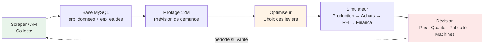

La boucle est **volontairement fermée** : chaque décision prise dans le simulateur devient la
référence du mois suivant, ce qui permet de mesurer l'effet réel des arbitrages sur la
trajectoire.

---

## 🏗️ Architecture générale

```mermaid
flowchart TB
    subgraph SRC["🌐 Source de données"]
        P["Portail Subakoua / Arkhe<br/>9 entreprises · 15 périodes<br/>91 études documentaires"]
    end

    subgraph ING["📥 Couche d'ingestion"]
        API["<b>subakoua_api.py</b><br/>Client REST authentifié<br/>Achat & lecture des études"]
        SCR["<b>scraper_subakoua.py</b><br/>Robot Playwright DOM<br/>11 modules · 5 décisions"]
        PLAN["<b>document_optimizer.py</b><br/>Plan d'achat sous contrainte<br/>Sac à dos utilité marginale"]
    end

    subgraph DB[("🗄️ MySQL · Aiven")]
        T1["<b>erp_donnees</b><br/>Données du portail par module"]
        T2["<b>erp_etudes</b><br/>Payloads des études achetées"]
        T3["<b>erp_scraper_runs</b><br/>Journal des exécutions"]
        T4["<b>Historique_Equipe</b> · <b>Parc_Machines_Mensuel</b><br/><b>Ventes_Historique</b> · <b>Decisions_RH_Mensuel</b><br/><b>Decisions_Marketing</b> · <b>Finances_Mensuelles</b>"]
        T5["<b>simulations_seeds</b><br/>Scénarios nommés"]
        T6["<b>Parametres_Nomenclature</b> · <b>Parametres_TempsAteliers</b><br/><b>Parametres_Globaux</b> · <b>Parametres_TarifsFournisseurs</b><br/><b>Normes_MS_Prod / Appro / Admin</b>"]
    end

    subgraph ANA["🧠 Moteurs d'analyse"]
        FE["<b>forecast_engine.py</b><br/>ETS · Holt amorti<br/>Backtest WAPE"]
        OE["<b>optimizer_engine.py</b><br/>Calibration ridge<br/>Grille de scénarios"]
        FI["<b>finance_engine.py</b><br/>Compte de résultat<br/>BFR · TVA · Dette"]
        DS["<b>document_strategy.py</b><br/>Matrice document → décision"]
        PC["<b>period_context.py</b><br/>Résolution M-1"]
    end

    subgraph UI["🖥️ Interface Streamlit"]
        P1["<b>erp_engine.py</b> · page 1<br/>Cockpit stratégique"]
        P2["<b>2_Scraper.py</b> · page 2<br/>🕷️ Ingestion & achats"]
        P3["<b>3_Pilotage_12M.py</b> · page 3<br/>🧭 Prévision"]
        P4["<b>4_Optimiseur_Strategique.py</b> · page 4<br/>🎯 Optimisation"]
    end

    P --> API
    P --> SCR
    API --> PLAN
    SCR --> T1
    PLAN --> T2
    API --> T2
    API --> T3

    T1 --> FE
    T2 --> FE
    T1 --> OE
    T2 --> OE
    T1 --> FI
    T2 --> FI
    T4 --> P1
    T5 --> P1
    T6 --> P1
    T6 --> P4
    PC --> P1

    FE --> P3
    FE --> P4
    OE --> P4
    FI --> P1
    DS --> P2

    P3 -.->|"lecture seule"| T1
    P4 -.->|"lecture seule"| T1
    P1 -.->|"lecture seule"| T1

    style SRC fill:#f0f7ff
    style DB fill:#fffbeb
    style ANA fill:#f5f3ff
    style UI fill:#ecfdf5
```

### Principes de conception

| Principe | Mise en œuvre |
|---|---|
| **Séparation des responsabilités** | Les moteurs (`*_engine.py`) sont **purs** : ni Streamlit, ni SQL. Ils sont testables unitairement. |
| **Pureté numérique** | Toute la finance utilise `decimal.Decimal` — aucun arrondi flottant. |
| **Défense en profondeur** | Le mode visiteur utilise un **utilisateur MySQL dédié**, limité à `SELECT`. |
| **Dégradation gracieuse** | Chaque requête critique est isolée : un échec dans une famille de données ne fait pas tomber les autres. |
| **Zéro fuite temporelle** | Aucune référence ne provient d'une période **postérieure** à la période simulée. |
| **Traçabilité** | Chaque chiffre affiché expose sa source et son mode de repli. |

---

## 📦 Les 5 modules

### Module 1 — 🕷️ Ingestion & achats documentaires (`pages/2_Scraper.py`)

Automatise la collecte de données et l'achat d'études, deux opérations qui coûtent de l'argent
réel et modifient la base.

**Trois onglets :**

| Onglet | Rôle |
|---|---|
| 🎯 **Plan documentaire** | Analyse le catalogue *live* et calcule un plan d'achat sous contrainte budgétaire |
| 📥 **Synchroniser** | Lit les études achetées et stocke leur payload en base |
| 🧱 **Secours DOM** | Extraction par robot Playwright (mode héritage, à éviter) |

**Fonctionnement du plan d'achat :**

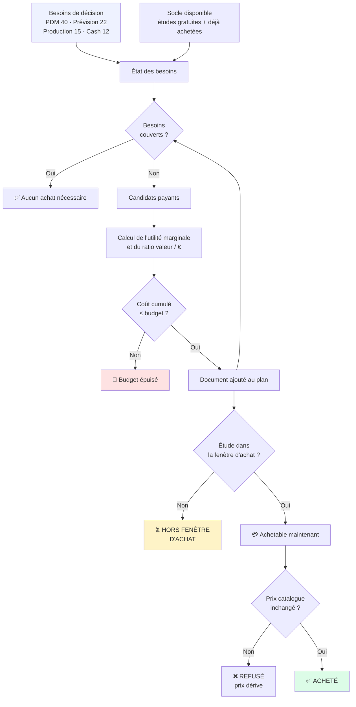

**Garde-fous de sécurité :**

- La **planification n'achète jamais** : l'exécution est une étape séparée.
- Une case à cocher explicite est **indispensable** pour déclencher un achat réel.
- Le prix affiché est **re-vérifié** dans le catalogue live juste avant l'achat.
- Après achat, le statut `boughtByTeam` est **re-interrogé** jusqu'à 6 fois pour confirmer.
- Les études à **5 000 €** ne sont **jamais** recommandées automatiquement.

> 🔒 Cette page est réservée au mode **Utilisateur** (`require_editor`).

---

### Module 2 — 🧭 Pilotage stratégique 12 mois (`pages/3_Pilotage_12M.py`)

Projecte la demande et la part de marché sur 12 mois à partir de la dernière période **réellement
observée**.

**Les 4 étapes :**

1. **Diagnostic des sources** — nombre de périodes, d'études, ventes reconnues, alertes.
2. **Validation hors-échantillon** — backtest à fenêtre glissante sur 3 méthodes candidates.
3. **Trajectoire** — graphique Altair des volumes par produit sur 12 mois.
4. **Écart à la cible** — unités à produire pour atteindre l'objectif de part de marché.

**Sortie :**

| Colonne | Signification |
|---|---|
| Ventes prévues (u) | Demande projetée |
| Marché projeté (u) | Taille du marché estimée |
| PDM base / PDM cible (%) | Position projetée vs objectif |
| Unités à produire-vendre | Quantité nécessaire pour la cible |
| Écart à combler (u) | Manque à couvrir |

> ⚠️ **Garde-fou anti-fuite** : la période d'ancrage est plafonnée à la dernière période
> réellement observée. On ne peut pas prévoir à partir de données futures.

---

### Module 3 — 🎯 Optimiseur stratégique (`pages/4_Optimiseur_Strategique.py`)

Cherche la combinaison de leviers qui maximise la **part de marché réalisable** sous contrainte
budgétaire et industrielle.

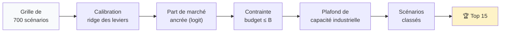

**Grille explorée (700 combinaisons) :**

| Variable | Valeurs candidates |
|---|---|
| Prix | 7 points (85 % → 115 % du prix de référence) |
| Publicité marque | 5 points (0 → 150 % de la référence) |
| Publicité produit | 5 points (0 → 150 % de la référence) |
| Qualité | 4 points (référence −5 → +10, plafonné à 100) |

**Critères de classement :**

1. **Part de marché réalisable** (critère principal)
2. **Pression sur les ateliers** (départage)
3. **Dépense marketing** (départage)

**Règle de classification :**

- 📗 **Budget dépassé** → scénario **infeasible** (contrainte bloquante)
- 🟨 **Capacité dépassée** → le scénario reste **valide**, le volume est **plafonné** au
  maximum industriel réalisable. L'application affiche la demande non servie et le taux de service.

> C'est un choix de conception important : une demande supérieure à la capacité ne rend pas la
> stratégie invalide, elle rend la stratégie **partiellement servie**.

---

### Module 4 — 🧠 Cockpit & Simulateur (`erp_engine.py`)

Page principale de l'application. Trois espaces de travail :

| Espace | Disponibilité | Contenu |
|---|---|---|
| 📊 État des lieux | Tous | Rendu structuré des 11 modules scrapés |
| 📥 Données réelles | Utilisateur | 6 formulaires de saisie (Stocks, Machines, RH, Marketing, Ventes, Finance) |
| 🎯 Centre de décision | Tous | Simulateur complet en 5 onglets |

> ✏️ L'espace « Données réelles » est **masqué** en mode visiteur, et l'espace de travail
> correspondant est retiré du menu latéral.

---

### Module 5 — 🔐 Authentification & rôles (`auth.py`, `auth_core.py`)

Voir la section [Sécurité](#-sécurité-rôles-et-accès).

---

## 🧮 Le simulateur : la chaîne de décision

C'est le cœur de l'application. Le simulateur prend les leviers stratégiques et propage leurs
conséquences à travers toute la chaîne de valeur.

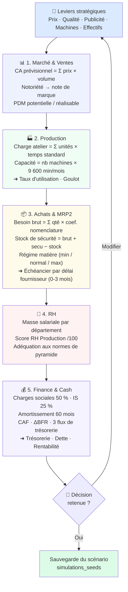

### Détail de la logique MRP2

Le calcul des besoins suit une nomenclature à trois régimes, choisis selon la qualité matière et
le score RH :

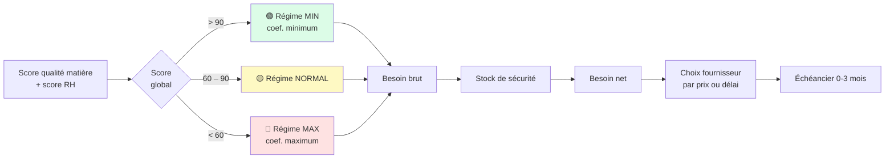

### Résolution du contexte temporel (M-1)

`period_context.py` résout une question récurrente : *« quelles données s'appliquent réellement au
mois que je simule ? »*

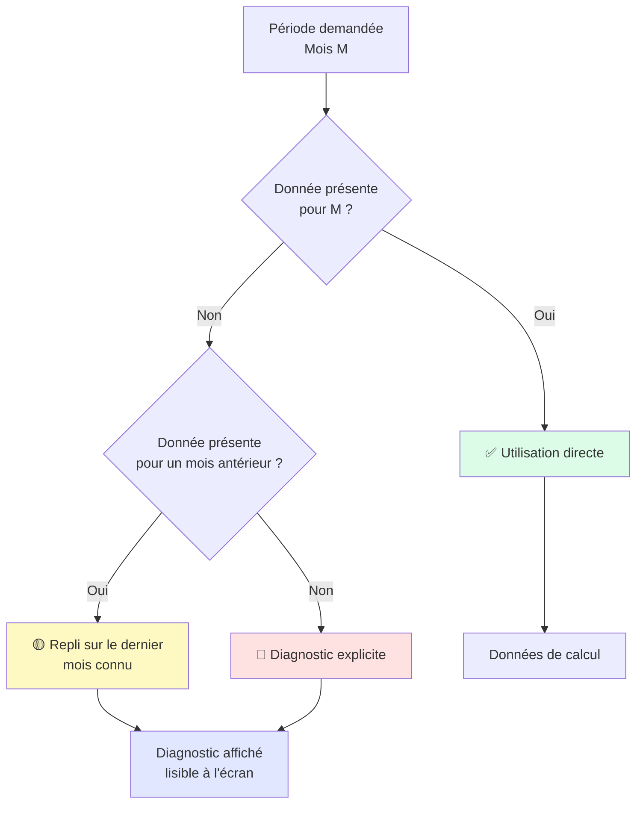

**Règles :**

- ✅ Le repli ne regarde **que vers l'arrière** — jamais de donnée future.
- ✅ Un enregistrement manuel (saisie) pour le mois exact **prime** sur la donnée scrapée.
- ✅ Le diagnostic est **visible** : l'utilisateur sait toujours s'il est en repli et sur quelle base.
- ✅ Changer de mois **purge** le cache de décisions (signature de contexte SHA-1).

---

## 🗃️ Modèle de données

```mermaid
erDiagram
    erp_donnees {
        int id PK
        varchar periode "Année 1 - Juin"
        varchar type_donnee
        varchar module "marketing, rh, production..."
        json contenu "Payload du portail"
        datetime date_maj
    }

    erp_etudes {
        varchar periode
        varchar study_id PK "bankStatements, pevc*..."
        varchar label
        varchar module
        float price
        varchar source_endpoint
        boolean read_allowed "Garde-fou anti-SPECIMEN"
        json payload
        datetime fetched_at
    }

    erp_scraper_runs {
        varchar run_id PK
        varchar mode
        varchar periods
        float estimated_cost
        float actual_cost
        varchar status
        json details
    }

    Historique_Equipe {
        int Tour_ID PK "1 à 15"
        float Stock_Neo3
        float Stock_Neo5
        float Stock_Neo7
        float Stock_Renforts
        float Stock_Manchons
        float Stock_Fermetures
        float Tresorerie_Initiale
    }

    Parc_Machines_Mensuel {
        int Tour_ID PK
        varchar Mois
        int Nb_Machines_Decoupe
        int Nb_Machines_Assemblage
        int Nb_Machines_Cond
        int Acquisition_Faite
    }

    Ventes_Historique {
        int Tour_ID PK
        varchar Mois
        int Ventes_S3
        int Ventes_I3
        int Ventes_S5
        int Ventes_I5
        int Ventes_I7
    }

    Decisions_RH_Mensuel {
        int Tour_ID PK
        varchar Mois
        int Eff_Employes_Prod
        float Sal_Employes_Prod
        int Eff_Cadres_Prod
        float Sal_Cadres_Prod
        int Eff_Directeurs_Prod
        float Sal_Directeurs_Prod
    }

    Decisions_Marketing {
        int Tour_ID PK
        varchar Mois
        float Prix_S3
        float Prix_I5
        float Budget_Marque
        varchar Axe_Principal
        varchar Axe_Accessoire
        float Pub_S3
        float Pub_I7
    }

    Finances_Mensuelles {
        int Tour_ID PK
        varchar Mois
        float CA_Net
        float Achats_Matieres
        float Remuneration_Personnel
        float Charges_Sociales
        float Dotations_Amortissements
        float Resultat_Net
        float Total_Capitaux_Propres
        float Emprunts_Bancaires
        float Disponibilites_Banque
    }

    simulations_seeds {
        varchar Token_Seed PK "sha1(tour:nom)"
        int Tour_ID PK
        varchar Nom_Scenario
        json Parametres_JSON
    }

    Parametres_Nomenclature {
        varchar Produit
        varchar Matiere
        float Coef_Min
        float Coef_Normal
        float Coef_Max
    }

    Parametres_TempsAteliers {
        varchar Produit
        float Temps_Decoupe
        float Temps_Assemblage
        float Temps_Conditionnement
    }

    Parametres_Globaux {
        varchar Nom_Parametre PK
        float Valeur "capacité, ratios..."
    }

    Parametres_TarifsFournisseurs {
        varchar Matiere
        float Prix_Qualite_35
        float Prix_Qualite_50
        float Prix_Qualite_70
        float Delai_Livraison
    }

    Normes_MS_Prod {
        float Effectif
        float Masse_Salariale_Satisfaisante
    }
```

### Rôle de chaque table

| Table | Rôle | Écriture |
|---|---|---|
| `erp_donnees` | Modules du portail scrapés (marketing, RH, production, banque, comptable…) | Scraper |
| `erp_etudes` | Payloads des études achetées | API / planificateur |
| `erp_scraper_runs` | Journal d'audit des exécutions (coût estimé / réel) | Planificateur |
| `Historique_Equipe` | Stocks de matières + trésorerie initiale | Saisie utilisateur |
| `Parc_Machines_Mensuel` | Parc machine par mois + investissements | Saisie utilisateur |
| `Ventes_Historique` | Ventes réelles par produit | Saisie / API |
| `Decisions_RH_Mensuel` | Effectifs et salaires par département | Saisie / parsing |
| `Decisions_Marketing` | Prix, budget marque, axes, publicité | Saisie / parsing |
| `Finances_Mensuelles` | Compte de résultat et bilan mensuels | Saisie utilisateur |
| `simulations_seeds` | Scénarios de décision nommés et réutilisables | Simulateur |
| `Parametres_*` | Nomenclature, temps d'atelier, seuils, tarifs fournisseurs | Administration |
| `Normes_MS_*` | Barèmes de masse salariale satisfaisante | Administration |

---

## 📐 Méthodes et algorithmes

### 1. Prévision (`forecast_engine.py`)

Trois modèles sont comparés, puis le meilleur est retenu par **validation hors-échantillon**.

| Modèle | Condition d'usage | Description |
|---|---|---|
| **ETS / Holt-Winters** | ≥ 24 observations | Triple exponentielle, tendance amortie + saisonnalité additive (période 12) |
| **Holt amorti** | ≥ 8 observations | Tendance amortie appliquée à la série désaisonnalisée |
| **Niveau saisonnier** | < 8 observations | Ancrage sur le dernier niveau × coefficients saisonniers |

**Sélection par backtest** — fenêtre glissante, prédiction à un pas, métriques **MAE / WAPE /
MAPE**, chaque prédiction n'utilisant que des données strictement antérieures au point de coupe.

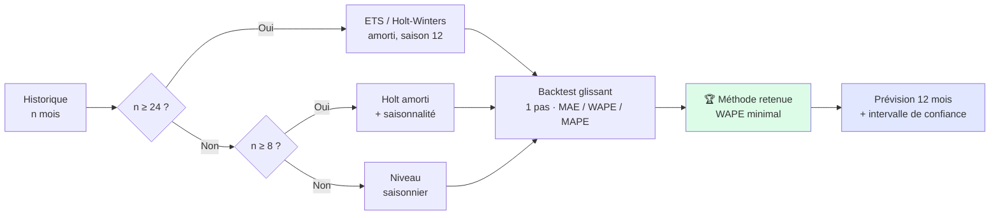

> Les intervalles de confiance sont dérivés de l'écart-type des résidus (±1,65 σ ou ±1,96 σ selon
> la méthode).

### 2. Optimisation (`optimizer_engine.py`)

**Calibration** — régression linéaire régularisée (**ridge**, α = 8) résolue en forme fermée :

```
β = (XᵀX + diag(0, α, α, α))⁻¹ Xᵀy
```

- Variables : prix, qualité, `log(1 + publicité marque)`, `log(1 + publicité produit)`
- Cible : `log(part de marché / 100)`
- Variables centrées-réduites pour la stabilité numérique
- **Confiance** déduite du nombre d'observations et de périodes : *faible* (0,35) ·
  *modérée* (0,65) · *bonne* (0,90)

**Part de marché ancrée** — plutôt que de prédire un niveau absolu inventé, le modèle applique une
**mise à jour en logit** sur la part observée :

```
logit(PDM_nouveau) = logit(PDM_référence) + shrink × Δutilité
```

> 📐 Ce mécanisme garantit que le modèle **ne fabrique jamais** un niveau de part de marché
> invérifiable : il ne fait qu'expliciter l'écart entre deux scénarios.

**Benchmark concurrentiel** — les payloads `pevc*` sont **fusionnés** afin de reconstituer le
marché complet, pas seulement la ligne de l'entreprise propre. Le nombre de concurrents est calculé
sur les **entreprises distinctes**, en excluant l'entreprise pilotée.

### 3. Finance (`finance_engine.py`)

Moteur **sans Streamlit ni SQL**, intégralement en `Decimal`.

| Paramètre | Valeur |
|---|---|
| TVA standard | 20 % |
| Charges sociales | 50 % de la masse salariale |
| Impôt sur les sociétés | 25 % |
| Durée d'amortissement | 60 mois |
| Rendement de l'épargne | 1,2 % / an |
| Nombre de parts | 40 000 |
| Accompte fournisseur | 30 % |
| Capacité machine | 9 600 min / machine / mois |

**Outputs calculés :** compte de résultat prévisionnel, TVA (payée à M+1), BFR par balances
clients / fournisseurs, CAF, trois flux de trésorerie (exploitation / investissement /
financement), dette bancaire, rentabilité (RAI/CA et RAI/capitaux propres), mensuelle **et**
cumulée.

### 4. Achat documentaire (`document_optimizer.py`)

Un **sac à dos à utilité marginale** glouton :

1. Les besoins de décision sont initialisés avec leur poids (PDM 40, Prévision 22, Production 15,
   Cash 12, Profit 7, RH 4).
2. La couverture de départ provient du **socle gratuit / déjà acheté**.
3. Chaque candidat payant est évalué par son **utilité marginale / prix**.
4. Sélection gloutonne par efficience décroissante jusqu'à épuisement du budget.

> La couverture est mesurée par une **matrice de preuves** (`NEED_EVIDENCE_WEIGHTS`) et non par
> une simple intersection de mots-clés : une étude ne couvre un besoin que si elle contient
> réellement les atomes d'information correspondants.

---

## 🔐 Sécurité, rôles et accès

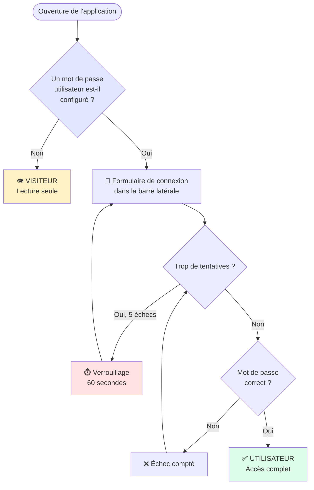

### Propriétés de sécurité

| Propriété | Mise en œuvre |
|---|---|
| **Fail-closed** | Aucun mot de passe configuré ⇒ **personne** ne peut devenir utilisateur |
| **Comparaison à temps constant** | `hmac.compare_digest` |
| **Support hash SHA-256** | Le mot de passe n'a pas besoin d'être stocké en clair |
| **Limitation de débit** | 5 tentatives, puis verrouillage de 60 secondes |
| **Expiration de session** | 8 heures, avec **déconnexion automatique** |
| **Horodatage vérifié** | Un rôle forgé dans `session_state` sans horodatage valide est **rejeté** |
| **Défense en profondeur** | Le visiteur utilise un **utilisateur MySQL en lecture seule** |
| **Protection serveur** | `require_editor()` appelle `st.stop()` — le CSS ne fait que le confort visuel |

### Matrice des droits

| Fonctionnalité | Visiteur | Utilisateur |
|---|:---:|:---:|
| Consulter l'état des lieux | ✅ | ✅ |
| Pilotage 12 mois | ✅ | ✅ |
| Optimiseur stratégique | ✅ | ✅ |
| Simuler une décision | ✅ | ✅ |
| Saisir les données réelles | ❌ | ✅ |
| Sauvegarder un scénario | ❌ | ✅ |
| Scraper & acheter des études | ❌ | ✅ |

> ⚠️ Le masquage de la page « Scraper » dans le menu est **purement visuel**. La vraie
> protection est appliquée côté serveur par `require_editor()`.

### Secrets

Le secret n'est **jamais** commité. Deux mécanismes de résolution, par ordre de priorité :

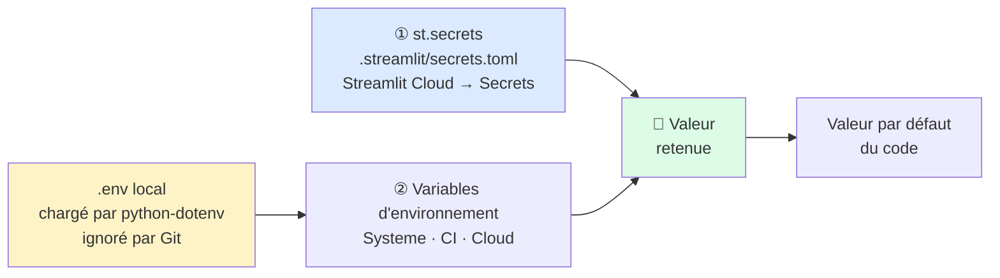

> `db_utils` applique une règle volontairement stricte : la section `[mysql_readonly]` **ne** dispose
> d'**aucun** repli sur les variables d'environnement `DB_*`, afin d'empêcher qu'un visiteur
> n'hérite par inadvertance de droits d'écriture.

---

## 🚀 Installation et lancement

### Prérequis

- **Python 3.10+**
- Un accès **MySQL** (Aiven ou équivalent)
- Des identifiants **Portail Subakoua** (pour le scraper et les achats)

### Installation

```bash
# 1. Cloner le dépôt
git clone https://github.com/Rami5090/erp-subakoua.git
cd erp-subakoua

# 2. Créer un environnement virtuel
python -m venv .venv
# Windows
.venv\Scripts\activate
# Linux / macOS
source .venv/bin/activate

# 3. Installer les dépendances
pip install -r requirements.txt
pip install -r requirements-dev.txt      # pytest

# 4. Installer le navigateur Playwright
playwright install chromium
```

### Lancement

> ℹ️ Le point d'entrée de l'application est **`erp_engine.py`**. Il doit être passé explicitement
> à `streamlit run`.

```bash
streamlit run erp_engine.py
```

L'application s'ouvre sur `http://localhost:8501` avec 4 pages dans le menu latéral.

### Exécuter les tests

```bash
python -m pytest -q
```

### Lancer le scraper

Le scraper s'exécute **en local**, jamais depuis l'application web.

```bash
# Une période, navigateur visible (diagnostic)
python scraper_subakoua.py --periods 1 --show-browser

# Toutes les périodes
python scraper_subakoua.py --all

# Headless, modules spécifiques
python scraper_subakoua.py --periods 1-15 --headless --modules marketing,rh,production

# Sonde de diagnostic — n'écrit RIEN en base
python scraper_subakoua.py --probe-decisions
```

**Options principales :**

| Option | Effet |
|---|---|
| `--periods 1,2,3` / `1-15` | Périodes à traiter |
| `--all` | Toutes les périodes disponibles |
| `--modules all,marketing` | Modules ciblés |
| `--force` | Ignore le mode incrémental |
| `--show-browser` | Affiche le navigateur |
| `--headless` | Mode sans interface |
| `--probe-decisions` | Diagnostic, **aucune écriture en base** |

> Sur Windows, les scripts `run_scraper.bat` et `scraper\run_scraper.bat` encapsulent ces
> commandes.

---

## ⚙️ Configuration

### Variables d'environnement (`.env`)

Copiez `.env.example` en `.env` (déjà ignoré par Git).

| Variable | Rôle |
|---|---|
| `SUBAKOUA_USER` | Identifiant du portail Subakoua |
| `SUBAKOUA_PASS` | Mot de passe du portail |
| `SUBAKOUA_LOGIN_URL` | URL de connexion |
| `SUBAKOUA_DASHBOARD_URL` | URL du tableau de bord |
| `DB_HOST` / `DB_PORT` | Hôte et port MySQL |
| `DB_USER` / `DB_PASSWORD` | Identifiants MySQL |
| `DB_NAME` | Nom de la base |
| `DB_SSL` | Active le SSL MySQL |
| `DB_SSL_CA` | Chemin du certificat CA (optionnel) |
| `SCRAPER_TIMEOUT_MS` | Délai d'attente du navigateur (défaut 30 000) |
| `SCRAPER_RETRIES` | Nombre de tentatives (défaut 3) |
| `ERP_USER_PASSWORD` | Mot de passe du mode Utilisateur |
| `ERP_USER_PASSWORD_SHA256` | Alternative hachée SHA-256 |
| `HEADLESS` | Mode sans interface |

### Secrets Streamlit (`.streamlit/secrets.toml`)

Pour le déploiement cloud, copiez `.streamlit/secrets.toml.example` :

```toml
[mysql]                 # droits d'écriture (mode Utilisateur)
host = ""
port = "3306"
user = ""
password = ""
database = ""

[mysql_readonly]        # OPTIONNEL mais recommandé : SELECT uniquement
host = ""
port = "3306"
user = ""
password = ""
database = ""

[auth]
user_password = ""      # ou : user_password_sha256 = "<hash>"

[subakoua]
user = ""
password = ""
```

**Générer un hash SHA-256 :**

```bash
python -c "import hashlib,getpass;print(hashlib.sha256(getpass.getpass().encode()).hexdigest())"
```

### Résolution de la configuration

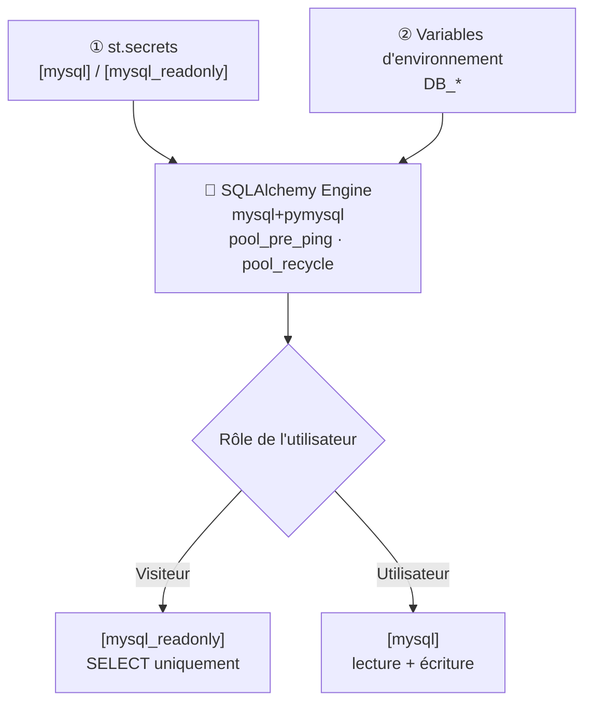

---

## ✅ Tests

```bash
python -m pytest -q
```

**Résultat actuel : `51 passed, 1 skipped`**

| Fichier de test | Couverture |
|---|---|
| `test_forecast_engine.py` | Saisonnalité, potentiel de marché, prévision 12 mois, **absence de fuite temporelle**, snapshot concurrentiel |
| `test_optimizer_engine.py` | Calibration ridge, prédiction de part, grille respectant le budget |
| `test_optimizer_capacity_limits.py` | Fusion des payloads `pevc*`, **capacité appliquée comme plafond et non comme rejet** |
| `test_document_optimizer.py` | Catalogue (91 études), priorités, exclusion des études à 5 000 €, fenêtre d'achat |
| `test_document_strategy.py` | Matrice documentaire complète, base gratuite comptée avant le plan payant |
| `test_auth_core.py` | Fail-closed, SHA-256, verrouillage, expiration de session |
| `test_auth_roles.py` | Blocage des pages en écriture, session forgée rejetée, **rôle jamais lu depuis l'URL** |
| `test_subakoua_api.py` | Résolution d'endpoint, substitutions de placeholders, **garde-fou `readAllowed`** |
| `test_study_ui_routes.py` | Routage UI, **aucune URL inventée** pour une étude inconnue |
| `test_competitor_ads.py` | Distinction publicité marque / produit (ignoré par défaut) |

### Points de qualité vérifiés par les tests

- ✅ **Aucune fuite temporelle** dans les prévisions
- ✅ **Aucune URL inventée** pour une étude inconnue
- ✅ **Aucun payload non lisible** n'est considéré comme acquis
- ✅ Les études **historiquement achetées** ne sont pas prises pour argent comptant
- ✅ Le **rôle ne provient jamais de l'URL**
- ✅ Le dépassement de capacité **plafonne** au lieu d'éliminer le scénario

---

## 📁 Structure du dépôt

```
erp-subakoua/
│
├── 🖥️ Interface Streamlit
│   ├── erp_engine.py                 # Page 1 · Cockpit & simulateur (~2 300 l.)
│   └── pages/
│       ├── 2_Scraper.py              # Page 2 · Ingestion & achats
│       ├── 3_Pilotage_12M.py         # Page 3 · Prévision 12 mois
│       └── 4_Optimiseur_Strategique.py   # Page 4 · Optimisation
│
├── 🧠 Moteurs d'analyse (purs, sans UI ni SQL)
│   ├── forecast_engine.py            # ETS, Holt, backtest, snapshots
│   ├── optimizer_engine.py           # Calibration, capacité, scénarios
│   ├── finance_engine.py             # Comptabilité prévisionnelle en Decimal
│   ├── strategic_engine.py           # Métriques et alertes concurrentielles
│   ├── period_context.py             # Résolution du contexte M-1
│   └── decisions_parser.py           # Parsing des décisions scrapées
│
├── 📥 Ingestion & documentation
│   ├── subakoua_api.py               # Client REST authentifié du portail
│   ├── scraper_subakoua.py           # Robot Playwright (11 modules)
│   ├── smart_scraper.py              # Orchestration planifier / acheter / synchroniser
│   ├── document_strategy.py          # Matrice document → information → décision
│   ├── document_optimizer.py         # Plan d'achat sous contrainte budgétaire
│   ├── study_catalog.py              # Accès au catalogue unifié
│   ├── study_ui_routes.py            # Résolution des routes UI
│   └── study_catalog.json            # 91 études (54 avec endpoint connu)
│
├── 🔐 Sécurité & infrastructure
│   ├── auth.py                       # Sessions et interface de connexion
│   ├── auth_core.py                  # Logique pure (fail-closed, throttle, TTL)
│   ├── db_utils.py                   # Moteur read-only vs write
│   └── constants.py                  # Produits, temps, nomenclature, périodes, finance
│
├── 🧪 Tests & outillage
│   ├── test_*.py                     # 51 tests exécutés + 1 ignoré
│   ├── simulator_smoke_runner.py     # Banc d'essai sans Streamlit ni MySQL
│   └── validate_study_routes.py      # Validateur de routage hors ligne
│
├── 📚 Documentation & configuration
│   ├── README.md                     # Ce document
│   ├── DOCUMENT_STRATEGY.md          # Stratégie d'achat documentaire (v2.5)
│   ├── scraper/README.md             # Guide de déploiement du scraper
│   ├── requirements*.txt
│   ├── packages.txt
│   ├── .env.example
│   └── .streamlit/
│       ├── config.toml               # Thème clair
│       └── secrets.toml.example      # Modèle de secrets
│
└── 🕷️ scraper/                        # Copie autonome (mode local)
    ├── scraper_subakoua.py
    ├── run_scraper.bat
    └── README.md
```

---

## 🚢 Déploiement

### Streamlit Community Cloud

1. Pousser le dépôt sur GitHub.
2. **New app** → sélectionner le dépôt.
3. ⚠️ **Point d'entrée à renseigner manuellement** : `erp_engine.py`

   > Le dépôt ne contient pas de `Home.py` ni de `streamlit_app.py`. Sans configuration
   > explicite, le déploiement peut échouer à trouver le script principal.
4. **Secrets** → coller le contenu de `.streamlit/secrets.toml.example`.
5. **Advanced settings** → `packages.txt` est déjà présent (Chromium pour Playwright).

> ⚠️ **Le scraper ne doit jamais être lancé depuis Streamlit Cloud.** L'extraction DOM et les achats
> sont conceived pour un usage **local**.

### Local

```bash
streamlit run erp_engine.py
```

---

## ❓ FAQ

**Le point d'entrée de l'application est-il `Home.py` ?**
Non. C'est `erp_engine.py`, accompagné des pages `2_`, `3_` et `4_` dans `pages/`.

**Puis-je partager l'application sans donner accès à l'écriture ?**
Oui. Configurez `[mysql_readonly]` avec un utilisateur MySQL **limité à `SELECT`**, et ne renseignez
aucun mot de passe dans `[auth]`. Tous les visiteurs resteront en lecture seule.

**Pourquoi les chiffres diffèrent-ils parfois des données du portail ?**
Parce que le simulateur applique les règles métier du jeu (temps d'atelier, nomenclature, normes
salariales, délais fournisseurs) que le portail n'expose pas directement. Chaque écran affiche
la source et le mode de repli utilisés.

**Le modèle est-il prédictif ou descriptif ?**
**Descriptif.** La calibration est explicitement indiquée comme non causale dans le code. Elle
explicite la corrélation observée entre leviers et part de marché, sans prétendre établir une
relation causale.

**Pourquoi la capacité limite-t-elle le scénario au lieu de l'éliminer ?**
Parce qu'une demande supérieure à la capacité industrielle ne rend pas une stratégie invalide :
elle la rend partiellement servie. L'application expose donc la demande non servie et le taux de
service, information plus utile qu'un simple rejet.

**Comment ajouter une nouvelle étude au catalogue ?**
Ajoutez une entrée dans `study_catalog.json` avec son `study_id`, son `label`, son `price`, son
`endpoint_path` (si connu) et ses `response_keys`, puis relancez les tests : ils vérifient
notamment le nombre d'études et les métadonnées d'endpoint.

**Faut-il déclarer `numpy` et `altair` explicitement ?**
Ces deux bibliothèques sont importées par le code et installées transitivement via
`statsmodels`, mais ne sont pas listées dans `requirements.txt`. En cas de problème
d'installation, ajoutez-les explicitement.

---

## 📸 Captures d'écran

> *Emplacement réservé.* Pour ajouter vos captures :
> 1. Créez un dossier `docs/` et déposez-y vos images.
> 2. Référencez-les ici avec ``.
>
> Suggestions : Cockpit · Pilotage 12 mois · Optimiseur · Centre de décision ·
> Plan documentaire.

---

## 📜 Licence

Ce projet est un **outil pédagogique et de démonstration**. Toute réutilisation, diffusion ou
modification est soumise à l'autorisation écrite de l'auteur.

Les données proviennent du portail de simulation **Subakoua / Arkhe** et restent la propriété de
leur éditeur. Ce dépôt ne contient aucune donnée chiffrée d'accès : les secrets sont systématiquement
exclus par `.gitignore`.

---

<div align="center">

**Développé avec Streamlit, pandas, statsmodels et MySQL**

<sub>ERP Subakoua · Cockpit stratégique · v2.9.x</sub>

</div>