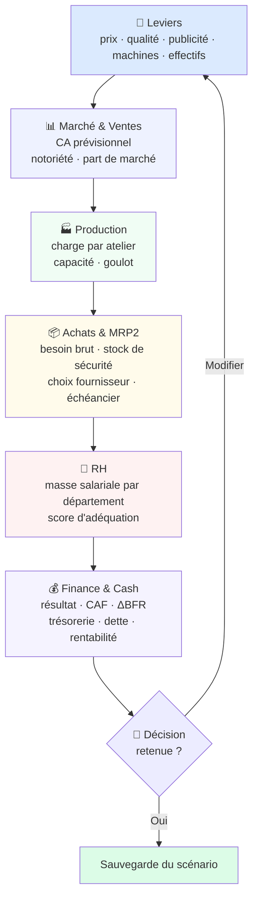

<div align="center">

# 🏭 ERP Subakoua

### Cockpit stratégique d'aide à la décision pour une entreprise de fabrication

**Analyse de marché · Prévision 12 mois · Optimisation de la part de marché · Simulation intégrée de la production, des achats, des RH et de la trésorerie**

[](https://www.python.org/)
[](https://streamlit.io/)
[](https://aiven.io/)
[](https://playwright.dev/)
[](https://docs.pytest.org/)

</div>

## 📑 Sommaire

Présentation · Architecture · [Les modules](#-les-modules) · [Le simulateur](#-le-simulateur) ·
[Méthodes](#-méthodes) · [Sécurité](#-sécurité-et-rôles) ·
[Installation](#-installation-et-lancement) · [Configuration](#-configuration) ·
[Tests](#-tests) · [Structure](#-structure-du-dépôt) · [FAQ](#-faq) · [Licence](#-licence)

## 🇬🇧 English summary

Strategic decision-support application built with Streamlit for a manufacturing company taking
part in a **business simulation game**. It ingests data from a third-party simulation portal,
forecasts demand over 12 months, optimises pricing / advertising / quality decisions against
competitors, and simulates the downstream effects on production, purchasing (MRP), HR and cash
flow.

| Capability | Implementation |
|---|---|
| **Ingestion** | Authenticated REST client + Playwright DOM scraper → MySQL |
| **Forecasting** | ETS / Holt-Winters, with **out-of-sample model selection** |
| **Optimisation** | Ridge calibration + deterministic grid search |
| **Capacity** | Per-workshop bottleneck model |
| **Break-even** | Break-even volume & revenue, safety margin, capacity-constrained margin-maximising mix |
| **Finance** | P&L, VAT, working capital, debt & cash flow in `Decimal` |
| **Data purchasing** | Marginal-utility knapsack over the study catalogue |
| **Access control** | Visitor (read-only) / User (full), fail-closed |

**Stack:** Python · Streamlit · pandas · statsmodels · SQLAlchemy · PyMySQL · Playwright · MySQL
**Entry point:** `erp_engine.py` · **Case-study data:** anonymised throughout this document

## 🎯 Présentation

L'ERP Subakoua est une **application d'aide à la décision** qui couvre la chaîne de valeur
complète d'une entreprise industrielle :

```
Marché → Prix & Publicité → Production → Achats → RH → Finance → Trésorerie
```

Elle se distingue d'un ERP classique sur trois points : elle **ingère ses données
automatiquement** depuis le portail de simulation plutôt que de reposer sur une saisie manuelle,
elle **projette** les conséquences des décisions à 12 mois face à un objectif concurrentiel, et
elle **simule** les cascades opérationnelles (capacité, MRP, masse salariale, trésorerie) pour
convertir une intuition en chiffres.

### Le cas d'étude

L'application est conçue pour un **scénario de simulation d'affaires** : plusieurs entreprises
concurrentes évoluent sur un même marché pendant un cycle de plusieurs périodes mensuelles.

> ⚠️ **Les données du cas d'étude sont volontairement anonymisées** dans ce document : libellés
> de produits, matières premières, ateliers et paramètres de simulation sont décrits de façon
> générique. Les valeurs réelles sont centralisées dans [`constants.py`](constants.py) et les
> tables de paramètres.

| Élément | Description générique |
|---|---|
| Catalogue | Une gamme de produits répartis par critère technique |
| Matières premières | Quelques références, consommées selon un ratio par produit |
| Ateliers | Trois postes de transformation enchaînés |
| Leviers de décision | Prix, qualité, publicité de marque, publicité produit |
| Concurrence | Plusieurs entreprises positionnées sur un même marché |

L'entreprise pilotée est **paramétrable**, et la période se choisit dans la barre latérale.

## 🏗️ Architecture

```mermaid
flowchart TB
    subgraph SRC["🌐 Source"]
        P["Portail de simulation<br/>marché, concurrence, décisions"]
    end
    subgraph ING["📥 Ingestion"]
        API["<b>subakoua_api.py</b><br/>client REST authentifié"]
        SCR["<b>scraper_subakoua.py</b><br/>robot Playwright DOM"]
        PLAN["<b>document_optimizer.py</b><br/>plan d'achat sous contrainte"]
    end
    subgraph DB[("🗄️ MySQL")]
        T1["<b>erp_donnees</b> · <b>erp_etudes</b><br/>données du portail et études"]
        T4["<b>Historique_*</b> · <b>Parc_Machines_Mensuel</b><br/><b>Ventes_Historique</b> · <b>Decisions_*</b><br/><b>Finances_Mensuelles</b> · <b>simulations_seeds</b>"]
        T6["<b>Parametres_*</b> · <b>Normes_MS_*</b><br/>référentiels administrables"]
    end
    subgraph ANA["🧠 Moteurs d'analyse"]
        FE["<b>forecast_engine.py</b><br/>ETS · Holt · backtest"]
        OE["<b>optimizer_engine.py</b><br/>calibration · scénarios"]
        FI["<b>finance_engine.py</b><br/>résultat · BFR · trésorerie"]
        PC["<b>period_context.py</b><br/>résolution du contexte"]
    end
    subgraph UI["🖥️ Interface Streamlit"]
        P1["<b>erp_engine.py</b> · page 1<br/>cockpit & simulateur"]
        P2["<b>2_Scraper.py</b> · page 2<br/>ingestion & achats"]
        P3["<b>3_Pilotage_12M.py</b> · page 3<br/>prévision"]
        P4["<b>4_Optimiseur_Strategique.py</b> · page 4<br/>optimisation"]
    end

    P --> API
    P --> SCR
    API --> PLAN
    SCR --> T1
    API --> T1
    PLAN --> T1

    T1 --> FE
    T1 --> OE
    T1 --> FI
    T4 --> P1
    T6 --> P1
    T6 --> P4
    PC --> P1
    FE --> P3
    FE --> P4
    OE --> P4
    FI --> P1

    style SRC fill:#f0f7ff
    style DB fill:#fffbeb
    style ANA fill:#f5f3ff
    style UI fill:#ecfdf5
```

### Principes de conception

| Principe | Mise en œuvre |
|---|---|
| **Moteurs purs** | Les `*_engine.py` ne dépendent ni de Streamlit, ni du SQL — donc testables unitairement |
| **Pureté numérique** | Toute la finance utilise `decimal.Decimal`, sans flottant |
| **Défense en profondeur** | Le mode visiteur utilise un utilisateur MySQL **distinct, limité à `SELECT`** |
| **Dégradation gracieuse** | Les requêtes sont isolées : un échec dans une famille de données n'entraîne pas les autres |
| **Zéro fuite temporelle** | Aucune référence ne provient d'une période postérieure à la période simulée |
| **Traçabilité** | Chaque chiffre affiche sa source et son mode de repli |

## 📦 Les modules

L'application comporte **4 pages** (le fichier racine est la page 1).

### Page 2 — 🕷️ Ingestion & achats documentaires

Automatise la collecte des données et l'achat des études du portail.

| Onglet | Rôle |
|---|---|
| 🎯 Plan documentaire | Analyse le catalogue *live* et calcule un plan d'achat sous contrainte budgétaire |
| 📥 Synchroniser | Lit les études achetées et stocke leur payload en base |
| 🧱 Secours DOM | Extraction par robot Playwright (mode héritage, à éviter) |

Le plan d'achat procède en trois temps : les **besoins de décision** sont définis et pondérés, le
**socle disponible** (études gratuites et déjà achetées) est déduit, puis les candidats payants
sont sélectionnés par **utilité marginale par euro dépensé** jusqu'à épuisement du budget.

**Garde-fous** : la planification **n'achète jamais** (l'exécution exige une case à cocher
explicite) ; le prix est **re-vérifié** dans le catalogue *live* avant achat, et le statut
d'achat **re-interrogé** après coup ; les études les plus coûteuses ne sont **jamais**
recommandées automatiquement.

> 🔒 Cette page est réservée au mode **Utilisateur** : elle dépense de l'argent réel.

### Page 3 — 🧭 Pilotage stratégique 12 mois

Projecte la demande et la part de marché sur 12 mois à partir de la dernière période
**réellement observée**, après validation de la méthode par backtest. Affiche la trajectoire des
volumes, la position concurrentielle face à l'objectif et l'écart en unités à combler, avec un
graphique Altair de la trajectoire mensuelle par produit.

> ⚠️ **Garde-fou** : la période d'ancrage est plafonnée à la dernière période réellement observée.
> On ne peut pas prévoir à partir de données futures.

### Page 4 — 🎯 Optimiseur stratégique

Cherche la combinaison de leviers qui **maximise la part de marché réalisable** sous contrainte
budgétaire et industrielle, en explorant prix, qualité et budgets publicitaires autour des valeurs
de référence.

**Deux règles de classification :**

- 📗 **Budget dépassé** → scénario **infeasible**, contrainte bloquante.
- 🟨 **Capacité dépassée** → le scénario reste **valide**, le volume est **plafonné** au maximum
  industriel réalisable. L'écran affiche la demande non servie et le taux de service.

> C'est un choix de conception assumé : une demande supérieure à la capacité ne rend pas une
> stratégie invalide, elle la rend **partiellement servie**.

### Page 1 — 🧠 Cockpit & simulateur

Page principale, trois espaces de travail :

| Espace | Disponibilité | Contenu |
|---|---|---|
| 📊 État des lieux | Tous | Rendu structuré des modules scrapés |
| 📥 Données réelles | Utilisateur | Saisie : stocks, machines, RH, marketing, ventes, finance |
| 🎯 Centre de décision | Tous | Simulateur complet |

### Page 6 — 📐 Analyse quantitative

Répond à trois questions, à partir des **données réelles** du mois (prix, coûts unitaires
variables, charges fixes, volumes, capacité) :

| Question | Réponse |
|---|---|
| **Combien vendre pour couvrir les charges fixes ?** | Point d'équilibre en unités et en CA, marge de sécurité, seuil par produit (charges fixes imputées au chiffre d'affaires) |
| **L'équilibre est-il atteignable ?** | La capacité industrielle borne le volume : si la marge maximale atteignable est inférieure aux charges fixes, l'équilibre est **hors de portée** — l'écart est affiché |
| **Comment maximiser la marge ?** | Mix proposé : les produits les plus rentables par unité de capacité rare sont servis d'abord, **sans jamais dépasser un atelier** |

Un tableau de **sensibilité** montre l'effet d'un choc de prix (−10 % à +10 %) sur le seuil.

> ⚠️ Le mix est une **heuristique gloutonne** (marge par fraction de capacité consommée) : la
> solution proposée est toujours réalisable, mais ce n'est pas un optimum exact de programme
> linéaire. Chaque donnée affichée indique sa source ; une donnée absente produit un
> avertissement, jamais un chiffre inventé.

## 🧮 Le simulateur

Le cœur de l'application : les leviers stratégiques sont propagés à toute la chaîne de valeur.



**La logique MRP2** applique un besoin brut par produit, un stock de sécurité, puis un choix de
fournisseur par critère de prix ou de délai. Le régime de nomenclature retenu dépend de la qualité
matière et du score RH, via des coefficients **minimum**, **normal** ou **maximum**.

### 🏭 Céder des machines

Le bloc **Machines : achats & cessions** (onglet Finance) permet de **sortir une machine du parc**
pour un prix de revente HT : **125 000 €** (Découpe), **150 000 €** (Assemblage), **40 000 €**
(Conditionnement), centralisés dans `constants.PRIX_CESSION_MACHINES` et modifiables dans l'écran.

| Effet | Règle appliquée |
|---|---|
| Parc | `parc actuel + achats − cessions`, **jamais négatif** |
| Cession excessive | Bridée au parc réellement détenu, **signalée** — seules les machines cédées sont payées |
| Trésorerie | Encaissement **TTC** immédiat, en flux d'investissement |
| TVA | TVA collectée sur la cession (20 %), hors chiffre d'affaires |
| Capacité | La machine cédée disparaît : la PDM réalisable baisse, la demande non servie et le taux de service suivent |
| Résultat | **Non modélisé** — la plus/moins-value et les dotations ne sont pas ajustées, faute de valeur nette comptable connue (un avertissement le rappelle à l'écran) |

Un atelier vidé alors qu'il est chargé rend le scénario **irréalisable** — un atelier simplement
saturé reste valide, la production y est simplement plafonnée.

### 🏭 Saisir une cession dans les données réelles

La saisie manuelle (**Données réelles** → onglets **🏭 Machines** et **💶 Finance**) connaît
désormais la cession, pour un mois **réel** :

- **🏭 Machines** — la case « *Des machines ont été cédées ce mois-ci ?* » (et le nombre de machines
  cédées par atelier, avec le prix HT unitaire réellement appliqué) est enregistrée en base.
  Le produit de cession, la TVA collectée et l'encaissement TTC sont affichés immédiatement.
- **💶 Finance** — l'impact comptable du mois est calculé et présenté :

  | Poste | Effet de la cession |
  |---|---|
  | Trésorerie (disponibilités banque) | **+** encaissement TTC |
  | Actif immobilisé | **−** valeur nette comptable des machines cédées |
  | Résultat net | **+** plus/minus-value (prix de cession − valeur nette comptable) |
  | TVA collectée (dette fiscale) | **+** 20 % du produit HT — à reporter dans le bilan du portail |

  La valeur nette comptable est **saisie par l'utilisateur** : tant qu'elle est inconnue, le
  résultat de cession et le retrait d'immobilisation ne sont **pas** calculés — aucun chiffre n'est
  inventé pour combler le vide, et l'avertissement est affiché.

  Le report sur les champs de saisie du mois est **opt-in** : par défaut, rien n'est modifié, car les
  soldes saisis proviennent du portail et incluent déjà l'encaissement de la cession. Un champ laissé
  à 0 (« non saisi ») n'est jamais écrasé par un report.

> 🔄 Les bases existantes sont complétées automatiquement (`db_schema.py`) : `CREATE TABLE IF NOT
> EXISTS` n'ajoute pas les colonnes d'une table déjà créée, l'application fait donc un `ALTER TABLE`
> idempotent au démarrage du mode Utilisateur.

**Le contexte temporel (M-1)** est résolu par `period_context.py` : si la donnée du mois simulé est
absente, l'application **replie sur le dernier mois antérieur connu** — jamais vers l'avenir. Le
diagnostic est affiché, et changer de mois purge le cache de décisions.

## 📐 Méthodes

### Prévision — `forecast_engine.py`

Trois modèles sont comparés, le meilleur est retenu par **validation hors-échantillon** :

| Modèle | Condition | Description |
|---|---|---|
| ETS / Holt-Winters | historique suffisant | Triple exponentielle, tendance amortie, saisonnalité additive |
| Holt amorti | historique intermédiaire | Tendance amortie sur série désaisonnalisée |
| Niveau saisonnier | historique court | Dernier niveau × coefficients saisonniers |

**Sélection** : backtest à fenêtre glissante, prédiction à un pas, métriques **MAE / WAPE / MAPE**,
chaque prédiction n'utilisant que des données strictement antérieures au point de coupe.

### Optimisation — `optimizer_engine.py`

- **Calibration** : régression **ridge** résolue en forme fermée, sur variables centrées-réduites,
  ciblant la part de marché. La confiance (*faible / modérée / bonne*) déduit du nombre
  d'observations.
- **Part de marché ancrée** : mise à jour en **logit** sur la part observée plutôt qu'une prédiction
  de niveau absolu — le modèle ne fabrique donc jamais de part de marché invérifiable.
- **Capacité** : l'excédent de charge est **plafonné** et remonté comme demande non servie.
- **Concurrence** : les fragments concurrents sont **fusionnés**, l'entreprise pilotée exclue du
  décompte.

### Finance — `finance_engine.py`

Moteur **sans Streamlit ni SQL**, intégralement en `Decimal` : compte de résultat prévisionnel,
TVA, BFR clients et fournisseurs, CAF, trois flux de trésorerie, dette bancaire et ratios de
rentabilité, **en mensuel et en cumulé**. Paramètres centralisés dans `constants.py`.

### Achat documentaire — `document_optimizer.py`

**Sac à dos à utilité marginale** : besoins pondérés → déduction du socle gratuit et déjà acquis →
sélection par efficience décroissante sous contrainte de budget. La couverture repose sur une
**matrice de preuves**, non sur une intersection de mots-clés.

## 🔐 Sécurité et rôles

| Propriété | Mise en œuvre |
|---|---|
| **Fail-closed** | Aucun mot de passe configuré ⇒ **personne** ne peut devenir utilisateur |
| **Comparaison à temps constant** | `hmac.compare_digest` |
| **Support hash SHA-256** | Le mot de passe n'a pas besoin d'être stocké en clair |
| **Limitation de débit** | 5 tentatives, puis verrouillage temporaire |
| **Expiration de session** | Déconnexion automatique au bout de quelques heures |
| **Horodatage vérifié** | Un rôle forgé dans `session_state` sans horodatage valide est **rejeté** |
| **Défense en profondeur** | Le visiteur utilise un **utilisateur MySQL dédié**, limité à `SELECT` |
| **Protection serveur** | `require_editor()` appelle `st.stop()` — le CSS ne fait que le confort visuel |

### Matrice des droits

| Fonctionnalité | Visiteur | Utilisateur |
|---|:---:|:---:|
| Consulter l'état des lieux | ✅ | ✅ |
| Pilotage 12 mois | ✅ | ✅ |
| Optimiseur stratégique | ✅ | ✅ |
| Simuler une décision | ✅ | ✅ |
| Saisir les données réelles | ❌ | ✅ |
| Sauvegarder un scénario | ❌ | ✅ |
| Scraper & acheter des études | ❌ | ✅ |

> ⚠️ Le masquage de la page « Scraper » dans le menu est **purement visuel** : la vraie
> protection est appliquée côté serveur par `require_editor()`. De même, `db_utils` refuse tout
> repli de `[mysql_readonly]` sur les variables `DB_*`, pour qu'un visiteur n'hérite jamais par
> inadvertance de droits d'écriture.

## 🚀 Installation et lancement

**Prérequis** : Python 3.10+, un accès MySQL (Aiven ou équivalent), et des identifiants du portail
de simulation.

```bash
# 1. Cloner et se placer dans le dépôt
git clone https://github.com/Rami5090/erp-subakoua.git
cd erp-subakoua

# 2. Environnement virtuel
python -m venv .venv
# Windows        →  .venv\Scripts\activate
# Linux / macOS  →  source .venv/bin/activate

# 3. Dépendances
pip install -r requirements.txt
pip install -r requirements-dev.txt      # pytest

# 4. Navigateur Playwright
playwright install chromium
```

### Lancer l'application

> ℹ️ Le point d'entrée est **`erp_engine.py`**. Il doit être passé explicitement à `streamlit run`.

```bash
streamlit run erp_engine.py     # → http://localhost:8501, 4 pages au menu latéral
```

### Lancer le scraper

Le scraper s'exécute **en local**, jamais depuis l'application web.

```bash
python scraper_subakoua.py --periods 1 --show-browser   # une période, navigateur visible
python scraper_subakoua.py --all                       # toutes les périodes
python scraper_subakoua.py --periods 1-15 --headless   # mode headless
python scraper_subakoua.py --probe-decisions           # diagnostic, n'écrit rien en base
```

Autres options : `--periods 1,2,3` ou `1-15`, `--modules all,marketing`, `--force`.

## ⚙️ Configuration

La configuration se résout par ordre de priorité : **`st.secrets`**, puis **variables
d'environnement**, puis **valeur par défaut** du code. Le fichier `.env` (local, ignoré par Git)
alimente les variables d'environnement.

### Secrets Streamlit — `.streamlit/secrets.toml`

```toml
[mysql]                 # droits d'écriture (mode Utilisateur)
host = ""
port = "3306"
user = ""
password = ""
database = ""

[mysql_readonly]        # OPTIONNEL mais recommandé : SELECT uniquement
host = ""
port = "3306"
user = ""
password = ""
database = ""

[auth]
user_password = ""      # ou : user_password_sha256 = "<hash>"

[subakoua]              # portail de simulation
user = ""
password = ""
```

**Générer un hash SHA-256 :**

```bash
python -c "import hashlib,getpass;print(hashlib.sha256(getpass.getpass().encode()).hexdigest())"
```

### Variables d'environnement clés

| Variable | Rôle |
|---|---|
| `SUBAKOUA_USER` / `SUBAKOUA_PASS` | Identifiants du portail |
| `DB_HOST` / `DB_PORT` / `DB_USER` / `DB_PASSWORD` / `DB_NAME` | Connexion MySQL |
| `ERP_USER_PASSWORD` ou `ERP_USER_PASSWORD_SHA256` | Mot de passe du mode Utilisateur |
| `HEADLESS`, `SCRAPER_TIMEOUT_MS`, `SCRAPER_RETRIES` | Comportement du scraper |

> 🚫 **Ne jamais commiter `.env` ni `secrets.toml`** — ils sont déjà couverts par `.gitignore`.

## ✅ Tests

```bash
python -m pytest -q
```

**Résultat actuel : `144 passed, 1 skipped`**

| Fichier | Couverture |
|---|---|
| `test_forecast_engine.py` | Saisonnalité, prévision 12 mois, **absence de fuite temporelle**, concurrence |
| `test_optimizer_engine.py` | Calibration, prédiction de part, grille respectant le budget |
| `test_optimizer_capacity_limits.py` | Fusion des données concurrentes, **capacité appliquée comme plafond** |
| `test_break_even_engine.py` | **Point d'équilibre exact**, imputation des charges fixes, mix sous contrainte de capacité, **équilibre hors de portée signalé** |
| `test_page_analyse_quantitative.py` | La page d'analyse s'exécute de bout en bout et produit un seuil cohérent |
| `test_machine_disposal.py` | **Cession de machines** : parc jamais négatif, cession bridée au parc détenu, encaissement TTC, TVA collectée sur cession, effet sur le taux de service |
| `test_cession_saisie_reelle.py` | Saisie réelle : produit de cession, impact comptable sans VNC, **migration de schéma idempotente** |
| `test_document_optimizer.py` | Priorités, exclusion des études onéreuses, fenêtre d'achat |
| `test_document_strategy.py` | Matrice documentaire, socle gratuit compté avant le plan payant |
| `test_auth_core.py` / `test_auth_roles.py` | Fail-closed, verrouillage, expiration, session forgée rejetée |
| `test_subakoua_api.py` / `test_study_ui_routes.py` | Endpoints, garde-fou de lisibilité, **aucune URL inventée** |

**Invariants protégés par les tests :** aucune fuite temporelle · aucune URL inventée · aucun
payload non lisible traité comme acquis · le rôle ne provient jamais de l'URL · le dépassement de
capacité plafonne au lieu d'éliminer le scénario · **on ne cède jamais plus de machines qu'on n'en
possède, et le parc ne descend jamais sous zéro**.

## 📁 Structure du dépôt

```
erp-subakoua/
├── erp_engine.py                 # Page 1 · Cockpit & simulateur
├── pages/                        # Pages 2-4 : ingestion, prévision, optimisation
│
├── forecast_engine.py            # ETS, Holt, backtest, concurrence
├── break_even_engine.py          # Point d'équilibre, marge, mix sous capacité
├── optimizer_engine.py           # Calibration, capacité, scénarios
├── finance_engine.py             # Comptabilité prévisionnelle (Decimal)
├── strategic_engine.py           # Métriques et alertes concurrentielles
├── period_context.py             # Résolution du contexte temporel
├── decisions_parser.py           # Parsing des décisions scrapées
│
├── subakoua_api.py               # Client REST authentifié du portail
├── scraper_subakoua.py           # Robot Playwright
├── smart_scraper.py              # Planifier / acheter / synchroniser
├── document_strategy.py          # Matrice document → information → décision
├── document_optimizer.py         # Plan d'achat sous contrainte budgétaire
├── study_catalog.py / .json      # Catalogue unifié des études
├── study_ui_routes.py            # Résolution des routes UI
│
├── auth.py / auth_core.py        # Sessions, rôles, limitation de débit
├── db_utils.py                   # Moteur lecture seule vs écriture
├── db_schema.py                  # Schéma local et migrations de colonnes
├── constants.py                  # Produits, temps, nomenclature, périodes, finance
│
├── test_*.py                     # 144 tests exécutés + 1 ignoré
├── simulator_smoke_runner.py     # Banc d'essai sans Streamlit ni MySQL
├── validate_study_routes.py      # Validateur de routage hors ligne
│
├── DOCUMENT_STRATEGY.md          # Stratégie d'achat documentaire
├── EVALUATION_NIVEAU_COMPETENCE.md # Auto-évaluation du niveau de compétence
├── scraper/                      # Copie autonome + guide de déploiement
├── requirements*.txt · packages.txt · .env.example
└── .streamlit/                   # config.toml · secrets.toml.example
```

## ❓ FAQ

**Le point d'entrée est-il `Home.py` ?**
Non. C'est `erp_engine.py`, accompagné des pages `2_`, `3_` et `4_` dans `pages/`. Sur Streamlit
Cloud, le point d'entrée doit être **renseigné explicitement**.

**Comment partager l'application en lecture seule ?**
Configurez `[mysql_readonly]` avec un utilisateur MySQL limité à `SELECT` et **ne renseignez aucun
mot de passe** dans `[auth]`. Tous les utilisateurs resteront visiteurs.

**Le modèle est-il prédictif ou descriptif ?**
**Descriptif.** La calibration est explicitement indiquée comme non causale dans le code : elle
explicite une corrélation observée, sans prétendre établir une relation causale.

**Pourquoi la capacité limite-t-elle un scénario au lieu de l'éliminer ?**
Parce qu'une demande supérieure à la capacité ne rend pas une stratégie invalide : elle la rend
partiellement servie. L'application expose donc la demande non servie et le taux de service.

**Comment ajouter une étude au catalogue ?**
Ajoutez une entrée dans `study_catalog.json` (identifiant, libellé, prix, endpoint, clés de
réponse), puis relancez les tests : ils vérifient la taille du catalogue et les métadonnées
d'endpoint.

## 📜 Licence

Outil pédagogique et de démonstration. Toute réutilisation ou diffusion est soumise à
l'autorisation écrite de l'auteur.

Les données proviennent d'un portail de simulation tiers et restent la propriété de son éditeur.
Aucun secret n'est présent dans ce dépôt : `.env` et `secrets.toml` sont exclus par `.gitignore`.

<div align="center">
<sub>ERP Subakoua · Cockpit stratégique · v2.9.x</sub>
</div>